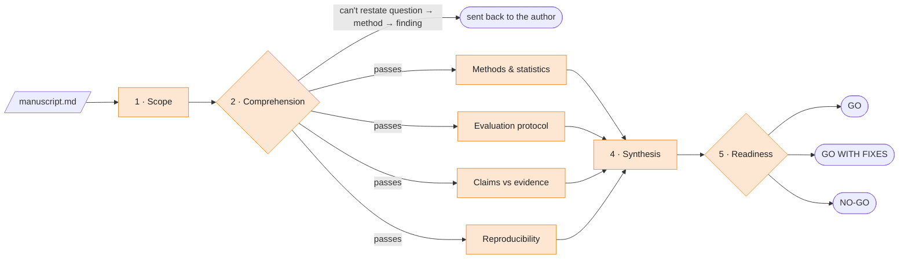

<p align="center">
  <picture>
    <source media="(prefers-color-scheme: dark)" srcset="docs/assets/readme-header-dark.svg">
    
  </picture>
</p>

<p align="center"><strong>Write research with an elephant. Referee it with a goldfish.</strong></p>

<p align="center">
  <a href="#install">Install</a> &ensp;·&ensp;
  <a href="#your-first-review-in-five-minutes">Quickstart</a> &ensp;·&ensp;
  <a href="#how-a-review-works">Review pipeline</a> &ensp;·&ensp;
  <a href="docs/getting_started.md">Documentation</a> &ensp;·&ensp;
  <a href="docs/designs/architecture.md">Architecture</a>
</p>

<p align="center">
  <a href="LICENSE"></a>
  
  
  <a href="CITATION.cff"></a>
</p>

<br>

<p align="center">
  <picture>
    <source media="(prefers-color-scheme: dark)" srcset="docs/assets/how-it-works-dark.svg">
  
  </picture>
</p>

**ERM** is an open-source plugin for AI agents (Claude Code first) that takes scientific work from research question to submission-ready manuscript, built around one rule about *who sees what*:

- 🐘 **Elephant** holds your whole project (conversation, notes, data, code, earlier decisions) and drafts with you.
- 🐟 **Goldfish** reviewers receive **only the document** and the files it cites. They referee it cold, like an anonymous reviewer who was never in the room.
- 🧑‍🔬 **You** make the scientific calls, accept or reject every finding, and sign the work.

> A goldfish that has been told what the elephant meant is no longer a goldfish.

## Why

When you write a paper together with an AI agent, you and the agent share the same blind spot. Both of you know what the text is *supposed* to mean, so neither of you notices what it fails to *say*:

| What you both "know" | What the text actually says | Who notices |
|---|---|---|
| Train and test came from different flocks | "Frames were randomly split 70/15/15" | Reviewer 2, three months later |
| The checkpoint was chosen on validation | "We report the best test F1" | Reviewer 2 |
| The method works in your four barns | "…suitable for commercial broiler production" | Reviewer 1 |

Asking the same agent to "review" its own draft does not help: it reads with the same context. ERM moves that cold read to **before** submission, by sending the document to fresh reviewers who never saw the conversation. It also keeps a record of what the AI did, so you can disclose it accurately.

## Install

**Claude Code**

```bash
claude plugin marketplace add siriani/elephant-referee-model
claude plugin install erm@erm
```

Start a new session after installing. Install the whole plugin: skills load the reviewer personas and rubrics at runtime. Reviews need a session that can create fresh sub-agents.

**Other agents.** Skills are plain Markdown and reviewers are standard sub-agent definitions, so ports to Codex, Antigravity, Gemini CLI and others are welcome. See [CONTRIBUTING](CONTRIBUTING.md).

## Your first review in five minutes

The repository ships a fictional manuscript with **14 planted problems** (leakage, test-set model selection, overstated claims, a wrong F1…). Use it to see what a goldfish review catches before you point ERM at your own work.

```text
/erm:erm-review tests/fixtures/toy_manuscript.md
```

Then compare the report in `erm-reviews/` with the answer key in [`tests/fixtures/README.md`](tests/fixtures/README.md). Every finding comes in the same shape:

```markdown
### F-01 [critical] Model selected on the test set
- **Type:** wrong
- **Location:** §2.3 Training
- **Evidence:** "The checkpoint with the best F1 on the test set was kept"
- **Why it matters:** reported performance is optimistically biased; the main comparison cannot be interpreted
- **Smallest fix:** select on a held-out validation split and re-report test results once
- **Needs new data or analysis:** yes
```

Severity reflects consequence, not effort: **critical** (the main conclusion may not hold), **major** (overstated or blocks reproduction), **minor** (clarity), **note** (strength worth keeping). See [`finding-format.md`](resources/standards/finding-format.md).

## From idea to submission

Each skill works on its own. The full sequence is optional.

```mermaid
flowchart LR
    Q([Research question]) --> B[erm-brainstorm]
    B -->|research_brief.md| P[erm-protocol]
    P -->|protocol.md| R1{{erm-review}}
    R1 --> S[(study runs)]
    S --> D[erm-draft]
    D -->|manuscript_draft.md| R2{{erm-review}}
    R2 --> X[erm-resolve]
    X --> DR[erm-drift]
    DR --> PV[erm-provenance]
    PV --> OK([You approve · submit])

    classDef goldfish fill:#fde7d2,stroke:#f08c2e,color:#1f2328
    classDef elephant fill:#e6e9ed,stroke:#7b848f,color:#1f2328
    class R1,R2 goldfish
    class B,P,D,X,DR,PV elephant
```



<sub>Grey: elephant skills, which work with your full context. Orange: goldfish reviews, which see only the file.</sub>

| Skill | Use it to… | Output |
|---|---|---|
| [`erm-brainstorm`](skills/erm-brainstorm/SKILL.md) | Sharpen a research question and hypotheses; six goldfish lenses challenge the idea | `research_brief.md` |
| [`erm-protocol`](skills/erm-protocol/SKILL.md) | Turn the brief into a study protocol, section by section, pausing for your feedback | `protocol.md` |
| [`erm-draft`](skills/erm-draft/SKILL.md) | Draft the manuscript from protocol, results and notes; every number carries a source tag | `manuscript_draft.md` |
| [`erm-review`](skills/erm-review/SKILL.md) | Referee a protocol or manuscript with zero-context goldfish across five stages | `erm-reviews/<doc>/…` |
| [`erm-resolve`](skills/erm-resolve/SKILL.md) | Work through the findings with you and revise only what you accept | revised document + `response_log.md` |
| [`erm-drift`](skills/erm-drift/SKILL.md) | Check that the text still says what the results, tables and code show | `drift_report.md` |
| [`erm-provenance`](skills/erm-provenance/SKILL.md) | Record how AI took part: models, prompts, sources, human interventions | `provenance.md` |

### Typical session

```text
/erm:erm-brainstorm Does early heat stress alter broiler gait scores detectable by video?
/erm:erm-protocol
/erm:erm-draft                       # after you have results
/erm:erm-review manuscript_draft.md
/erm:erm-resolve
/erm:erm-drift
/erm:erm-provenance
```

## How a review works

`erm-review` runs five stages. Each goldfish is a fresh sub-agent with its own versioned rubric in [`resources/standards/`](resources/standards/).



1. **Scope.** Does the work fit the field and the target venue? Is the contribution stated against the state of the art?
2. **Comprehension.** Can a reader with no context restate question → method → finding? If not, the document goes back before anyone critiques it.
3. **Critique**, in parallel: methods and statistics, evaluation protocol (for model-based work), claims against evidence, reproducibility.
4. **Synthesis.** The only goldfish that reads the other reports. It merges, deduplicates and ranks findings by severity.
5. **Readiness.** Go / no-go: could an independent group reproduce this, and is everything a journal will ask for present?

## Rules ERM enforces

| Rule | What it means in practice |
|---|---|
| **Isolation** | Goldfish receive file paths only. Never the conversation, a summary of it, or what the author meant. If the agent cannot create isolated sub-agents, the review **stops** instead of pretending. |
| **You decide** | Findings are evidence to weigh, not verdicts. ERM never edits your document on a finding you have not accepted. |
| **No invented references** | Unknown citations are marked `[citation needed]`, never filled in. |
| **Traceable numbers** | Numbers in drafts carry source tags, so drift between text and results can be checked mechanically. |
| **Provenance** | AI contributions are recorded so you can disclose them accurately. |
| **Confidentiality** | Do **not** use ERM on manuscripts you received for confidential peer review unless the journal's policy explicitly allows AI tools. |

## How it is built

| Layer | Folder | Holds | Changes when |
|---|---|---|---|
| Skills | [`skills/`](skills/) | Orchestration: inputs, stages, hand-off | The workflow changes |
| Personas | [`agents/`](agents/) | The judgment stance of each goldfish | A reviewer role changes |
| Standards | [`resources/standards/`](resources/standards/) | Versioned criteria and finding format | The criteria change |

Skills never contain criteria; personas cite standards by file name. A lab can revise a rubric, or add one for its own field, without touching prompts or forking the plugin. Details in [architecture.md](docs/designs/architecture.md).

## Limits

A goldfish review does not replace experiments, sound statistics, domain expertise or human peer review. Goldfish can miss problems, misread a method, or share the biases of the underlying model. Using a different model for the reviewers than for the elephant reduces shared blind spots but does not remove them.

## Background

ERM builds on two sources.

**Google's [Elephant-Goldfish Model](https://github.com/google/elephant-goldfish-model) (EGM)** gives the core pattern: a context-rich agent drafts, and fresh reviewers with no shared memory review the draft. ERM moves that pattern from software design to scientific research. The documents become research briefs, protocols and manuscripts, and the reviewers become scientific referees. The rubrics encode failure modes specific to research, such as pseudo-replication, data leakage, selection on the reporting split, overstated claims and undisclosed AI involvement. The memory metaphor comes from [Dave Rensin's essay](https://medium.com/@drensin/elephants-goldfish-and-the-new-golden-age-of-software-engineering-c33641a48874).

**Feng et al. (2026), *[Agentic AI systems for scientific discovery](https://doi.org/10.1038/s43586-026-00534-y)***, a Nature Reviews Methods Primer, gives the scientific requirements that shaped ERM's rules:

| The Primer argues that… | …so ERM |
|---|---|
| Multi-agent systems split research into roles, including **critics**, coordinated through a shared workflow | uses separate goldfish critics for methods, evaluation, claims and reproducibility, merged by a synthesizer |
| **Human-in-the-loop** checkpoints belong at consequential decisions, to catch compounding errors and preserve accountability | never applies a finding you have not accepted, and ends every review with a go / no-go decision that you make |
| Human intervention should be **documented explicitly**, making clear which steps were autonomous and which depended on expert correction | records models, prompts, sources and human interventions in `provenance.md` |
| Results should keep the **provenance** that links them back to earlier agent decisions | tags numbers in drafts with their source, so `erm-drift` can check text against results |
| **Hallucinated facts** and unsupported inference are major failure modes | never invents references, and audits claims against evidence |

ERM is an independent project, not affiliated with or endorsed by Google or by the Primer's authors. See [NOTICE](NOTICE).

### References

- Feng, B., Walther, P., Zhang, L., *et al.* (2026). Agentic AI systems for scientific discovery. *Nature Reviews Methods Primers*, 6, 81. https://doi.org/10.1038/s43586-026-00534-y
- Google. *Elephant-Goldfish Model (EGM)*. https://github.com/google/elephant-goldfish-model
- Rensin, D. *Elephants, goldfish, and the new golden age of software engineering*. Medium. https://medium.com/@drensin/elephants-goldfish-and-the-new-golden-age-of-software-engineering-c33641a48874

## Cite and license

If ERM helps your work, please cite it with [CITATION.cff](CITATION.cff) (GitHub's **Cite this repository** button). Released under the [Apache License 2.0](LICENSE).
